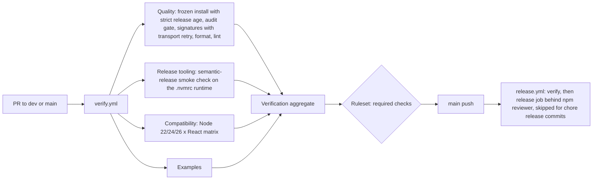

# Flow Stack CI Hardening Architecture and Implementation Plan

> Status: IN PROGRESS
>
> Plan version: 2.0
>
> Revision: 7
>
> Last updated: 2026-11-27
>
> Repository/workspace: `clalexander/flow-stack`
>
> Branch: `dev`
>
> Baseline commit: `1f7502a7f2be3224bc55b68c4bac3a629899c14c`
>
> Working tree: Clean at planning baseline
>
> Canonical location: `docs/plans/flow-stack-ci-hardening-plan.md`
>
> Current phase: Phase 1
>
> Implementation authorization: Phase 1 authorized on 2026-11-24 ("Save the flow-stack plan and start on the first step")
>
> Supersedes: The release-age choice of `flow-stack-ci-modernization-plan.md` step 4.4 (P4-T004), and resumes its deferred P5-T003 and P5-T004 with the amendments in DEC-010 to DEC-012

## Purpose

The 2026-11-24 dependency release (#87 to #90) showed that several CI guarantees documented in `docs/development/ci.md` and `docs/development/release.md` are not in force:

- the blocking vulnerability gate cannot fail;
- PR verification never runs the release tool;
- no required checks or publish reviewer are configured;
- no release-age limit exists for transitive dependencies.

This plan restores those guarantees in four reviewable phases and records the decisions taken.

Only the phases listed under Implementation authorization may be executed.

## Intent and Goals

### Intent

Every documented CI guarantee is enforced by configuration and proven by an observed run, so that dependency releases can follow `release-dependency-updates` without the agent compensating for missing enforcement.

### Goals

1. Blocking supply-chain gates fail when they should: vulnerability audit, release age, and signatures.
2. A change that breaks the release job fails PR verification, not the release on `main`.
3. Branch rulesets and the `npm` environment enforce what the docs describe.
4. Docs, configuration, and observed behavior agree.

### Success Outcomes

- A red run proves that each new or changed blocking gate can fail, or the documented behavior of the pinned tool is cited where a failure cannot be produced on demand.
- `main` and `dev` reject merges without `Verification` and `Validate PR title`.
- A release to npm waits for the maintainer's approval.

## Scope

### In Scope

- `.github/workflows/verify.yml`, `release.yml`, `dependency-release.yml`, `pages.yml`, `react-major-support.yml`, `.github/dependabot.yml`
- `package.json` (`packageManager`), `pnpm-workspace.yaml`, `pnpm-lock.yaml`
- New file `.nvmrc`
- `docs/development/README.md`, `ci.md`, `release.md`, this plan
- Repository settings: branch rulesets, the `npm` environment, Actions variables

### Out of Scope

- Library source, tests, examples, and the published package contents.
- The reference monorepo (`npm-packages`), which has the same pnpm 12.3.1 audit gap; it is reported to the maintainer separately.
- Changing the release model (semantic-release, `dev` → `main` promotion, merge methods).

### Deferred Possibilities

- An analysis-only semantic-release dry run on PRs, beyond the version smoke check in DEC-007.
- Automated deletion of promotion branches whose PRs close without merging.

## Execution Protocol

1. Execute only the authorized phase's backlog. Stop at every phase boundary and request explicit authorization for the next phase.
2. Reread this plan before starting each phase and after any context loss.
3. Every branch, commit, push, pull request, merge, and settings change needs approval for that action (version-control rule). Commits and PRs carry no AI attribution.
4. Commands that install tools or dependencies, switch the package-manager version, or write package stores need explicit approval of the exact command (environment-safety rule).
5. New in-scope work is added to this plan before it is executed. Out-of-scope or intent-changing work needs the maintainer's direction first.
6. Update the Phase Summary, the backlog statuses, and the revision log at each phase boundary.

## Planning Baseline

| Field                    | Value                                                                                                                   | Evidence                        |
| ------------------------ | ----------------------------------------------------------------------------------------------------------------------- | ------------------------------- |
| Repository root          | `clalexander/flow-stack`                                                                                                | `git remote -v`                 |
| Branch                   | `dev` at `1f7502a` (after sync PR #90)                                                                                  | `git log -1`                    |
| Package manager          | `pnpm@12.3.1`                                                                                                           | `package.json` `packageManager` |
| Release runtime          | Node 26 (since #88)                                                                                                     | `.github/workflows/release.yml` |
| Existing plans           | `flow-stack-ci-modernization-plan.md` (COMPLETE; P5-T003 and P5-T004 deferred), `release-governance-plan.md` (COMPLETE) | `docs/plans/`                   |
| Working-tree constraints | Local `node_modules` predates the #87 lockfile; refreshing it needs approval                                            | session record                  |

## Phase Summary

| Phase | Conceptual Boundary                   | Test Scope                   | Dependencies   | Risk   | Status      | Stage A        | Stage B        | Stage C     | Backlog Progress | Authorization       | Acceptance          |
| ----- | ------------------------------------- | ---------------------------- | -------------- | ------ | ----------- | -------------- | -------------- | ----------- | ---------------- | ------------------- | ------------------- |
| 1     | Supply-chain gates                    | NONE (CI run evidence)       | None           | Medium | COMPLETE    | NOT APPLICABLE | NOT APPLICABLE | COMPLETE    | 6 / 6 complete   | Received 2026-11-24 | Received 2026-11-25 |
| 2     | Release runtime and automation        | NONE (CI run evidence)       | Phase 1        | Medium | IN PROGRESS | NOT APPLICABLE | NOT APPLICABLE | IN PROGRESS | 3 / 6 complete   | Received 2026-11-25 | Not received        |
| 3     | Documentation alignment and promotion | NONE                         | Phases 1-2     | Low    | NOT STARTED | NOT APPLICABLE | NOT APPLICABLE | NOT STARTED | 0 / 3 complete   | Not received        | Not received        |
| 4     | Enforcement and controlled acceptance | NONE (controlled rule tests) | Phase 3; Q-001 | High   | NOT STARTED | NOT APPLICABLE | NOT APPLICABLE | NOT STARTED | 0 / 5 complete   | Not received        | Not received        |

Stages A and B do not apply: the phases change configuration and workflows, not types or tested code.

## Requirement Sources

| Source ID | Source                                                                                                     | Authority/Scope   | Relevant Material                                                                            |
| --------- | ---------------------------------------------------------------------------------------------------------- | ----------------- | -------------------------------------------------------------------------------------------- |
| SRC-000   | `plan-initiative` protocol                                                                                 | Process           | Phase gates, backlog control, reread                                                         |
| SRC-001   | Maintainer, 2026-11-24                                                                                     | Initiative        | CI issues 1-9 from the #87 release; decisions D1, D2, D4, D5; Phase 1 authorization          |
| SRC-002   | `docs/development/ci.md`, `docs/development/release.md`                                                    | Repository intent | Required checks, npm reviewer, audit gate, promotion                                         |
| SRC-003   | `flow-stack-ci-modernization-plan.md`                                                                      | Prior plan        | SR-008, M-002, M-004, P4-T004, P5-T003, P5-T004                                              |
| SRC-004   | Workflows, `pnpm-workspace.yaml`, `.github/dependabot.yml`, rulesets, environments                         | Current behavior  | See Current-State Observations                                                               |
| SRC-005   | pnpm release notes v12.3.0, v12.16.0; pnpm.io audit and settings docs; GitHub Dependabot options reference | Tool behavior     | Audit exit codes, release-age strictness, cooldown support                                   |
| SRC-006   | Maintainer rules: version control, environment safety, development                                         | Process           | Approval per action, no attribution, no environment changes without approval                 |
| SRC-007   | Maintainer, 2026-11-25                                                                                     | Process           | Phase 1 accepted; Q-002 answered; Phase 2 authorized; PRs merge only after maintainer review |

## Active Requirements

### Functional Requirements

| ID     | Requirement                                                                                                               | Source           | Verification                                           | Status |
| ------ | ------------------------------------------------------------------------------------------------------------------------- | ---------------- | ------------------------------------------------------ | ------ |
| FR-001 | The fixable-vulnerability step fails when a fixable advisory at or above the audit level is not ignored.                  | SRC-001, SRC-002 | Red run (CASE-001)                                     | ACTIVE |
| FR-002 | No current advisory remains unaddressed: each one is fixed, or ignored with a reason and a removal condition.             | SRC-001          | Green Quality run; config review                       | ACTIVE |
| FR-003 | Every resolved version, including transitive ones, is at least 2 days old unless excluded by exact version with a reason. | SRC-001 (D1)     | Config review; CASE-004 by documented behavior         | ACTIVE |
| FR-004 | GitHub Actions version updates have a cooldown.                                                                           | SRC-001          | Config review                                          | ACTIVE |
| FR-005 | Signature verification retries registry transport errors and never retries signature failures.                            | SRC-001          | Review; CASE-006 to CASE-008                           | ACTIVE |
| FR-006 | PR verification fails when the release tool cannot run on the release runtime.                                            | SRC-001          | Red run (CASE-009)                                     | ACTIVE |
| FR-007 | The release runtime is declared once and used by every job that runs release tooling.                                     | SRC-001          | Review                                                 | ACTIVE |
| FR-008 | Node 26 is in the compatibility matrix.                                                                                   | SRC-001          | Green matrix                                           | ACTIVE |
| FR-009 | Pushes of `chore(release): ` commits run verification but skip the release job.                                           | SRC-001 (D2)     | CASE-010 run                                           | ACTIVE |
| FR-010 | App tokens use `client-id`.                                                                                               | SRC-001          | No deprecation warning; token steps succeed            | ACTIVE |
| FR-011 | Every single-runtime CI job reads its Node version from `.nvmrc`; only the compatibility matrix lists Node versions.      | SRC-008          | Review; `node-version:` appears only in the matrix job | ACTIVE |

### Security and Operational Requirements

| ID     | Requirement                                                                                                         | Source                  | Verification                             | Status |
| ------ | ------------------------------------------------------------------------------------------------------------------- | ----------------------- | ---------------------------------------- | ------ |
| SR-001 | `main` and `dev` rulesets require a PR, `Verification`, and `Validate PR title`, and block force-push and deletion. | SRC-002, SRC-003 SR-008 | Ruleset export; controlled tests         | ACTIVE |
| SR-002 | Only the Release Automation App may bypass, and only on `main`.                                                     | SRC-003 SR-008          | Ruleset export; release-commit test      | ACTIVE |
| SR-003 | The `npm` environment requires the maintainer's approval and deploys only from `main`.                              | SRC-002, SRC-001 (D2)   | Environment export; pending-approval run | ACTIVE |
| SR-004 | No long-lived npm token or broad bypass is introduced.                                                              | SRC-002                 | Review                                   | ACTIVE |

### Testing and Validation Requirements

| ID     | Requirement                                                                                                                         | Source  | Verification        | Status |
| ------ | ----------------------------------------------------------------------------------------------------------------------------------- | ------- | ------------------- | ------ |
| TR-001 | Each PR merges only after `Verification` and `Validate PR title` pass on its exact head SHA.                                        | SRC-001 | Run IDs in closeout | ACTIVE |
| TR-002 | Each new or changed blocking gate has a recorded red run, or cites documented behavior when a failure cannot be produced on demand. | SRC-001 | Closeout evidence   | ACTIVE |

### Process Requirements

| ID      | Requirement                                                                                                  | Source     | Verification                                                                             | Status |
| ------- | ------------------------------------------------------------------------------------------------------------ | ---------- | ---------------------------------------------------------------------------------------- | ------ |
| PR-001  | Implementation is limited to the authorized phase backlog.                                                   | SRC-000    | Closeout                                                                                 | ACTIVE |
| PR-002  | Reread this plan before each phase and after context loss.                                                   | SRC-000    | Checkpoint                                                                               | ACTIVE |
| PR-003  | Every PR title is a non-releasing type (`build:`, `ci:`, `docs:`).                                           | SRC-001    | PR titles; no-op release                                                                 | ACTIVE |
| PR-004  | Docs change in the same PR as the behavior they describe.                                                    | SRC-001    | Diff review                                                                              | ACTIVE |
| PR-005  | Every adopted version meets the cooldown for its update type.                                                | SRC-001    | Age check in closeout                                                                    | ACTIVE |
| PR-006  | Approval per git action, no AI attribution, and no environment change without approval of the exact command. | SRC-006    | Session record                                                                           | ACTIVE |
| PR-007  | From Phase 2 on, a PR merges only after the maintainer approves it, in addition to TR-001.                   | SRC-007    | PR review record                                                                         | ACTIVE |
| SRC-008 | Maintainer, 2026-11-25 (option B)                                                                            | Initiative | `.nvmrc` is the one Node version source for single-runtime CI jobs and local development |

## Acceptance Criteria

| ID     | Acceptance Criterion                                                            | Requirements     | Evidence                 |
| ------ | ------------------------------------------------------------------------------- | ---------------- | ------------------------ |
| AC-001 | Quality fails on an unignored fixable advisory and passes after remediation.    | FR-001, FR-002   | Phase 1 run IDs          |
| AC-002 | Release age and the Actions cooldown are configured and documented.             | FR-003, FR-004   | Diff; ci.md              |
| AC-003 | Release tooling fails verification when the release runtime is too old.         | FR-006, FR-007   | Phase 2 run IDs          |
| AC-004 | Promotion to `main` releases nothing and the sync PR merges.                    | PR-003           | Phase 3 run IDs          |
| AC-005 | Rulesets and the npm reviewer enforce SR-001 to SR-003.                         | SR-001 to SR-003 | Phase 4 controlled tests |
| AC-006 | `ci.md` and `release.md` match the configuration (DISC-001 to DISC-004 closed). | PR-004           | Docs diff                |

## Assumptions and Constraints

### Assumptions

| ID      | Assumption                                                                                               | Basis                                                | Risk if False               | Resolution                                                |
| ------- | -------------------------------------------------------------------------------------------------------- | ---------------------------------------------------- | --------------------------- | --------------------------------------------------------- |
| ASM-001 | Dependabot can update a pnpm 12.22 lockfile.                                                             | It updates the current 12.3.1 lockfile.              | Dependency PRs fail to open | Observe the next Dependabot run; revert DEC-003 if needed |
| ASM-002 | Dependabot may resolve transitive versions younger than `minimumReleaseAge`.                             | Its cooldown scope covers only updated dependencies. | Such PRs fail Quality       | Recreate the PR once the versions age (skill playbook)    |
| ASM-003 | A skipped required check (`Validate PR title` on `release/*` heads) counts as passing.                   | GitHub required-check behavior                       | Promotion PRs blocked       | Verify in P4-T003; adjust the check's trigger if not      |
| ASM-004 | Strict release age leaves enough mature versions for the compatibility job's `pnpm add` of React majors. | Mature versions exist for each major                 | Matrix job fails            | Observe the first Phase 1 run                             |

### Constraints

- Local tooling may not be installed or switched without approval (SRC-006). The authoritative validation is CI.
- `.github/dependabot.yml` changes take effect only once they reach `main`.

## Material Open Questions

| ID    | Question                                                                          | Why It Matters                                           | Owner      | Required Before  | Status                                   |
| ----- | --------------------------------------------------------------------------------- | -------------------------------------------------------- | ---------- | ---------------- | ---------------------------------------- |
| Q-001 | Require linear history on `main` and `dev` (D3)?                                  | Conflicts with the merge-commit promotion and sync model | Maintainer | Phase 4          | OPEN                                     |
| Q-002 | Confirm Test Scope NONE for all phases, with CI run evidence instead of new tests | Template requires a user-answered test scope             | Maintainer | Phase 1 closeout | ANSWERED 2026-11-25: NONE for all phases |

## Terminology

- **Cooldown**: Dependabot's delay before proposing a version update. It applies only to the dependency being updated and not to security updates.
- **Release age**: pnpm's `minimumReleaseAge`. It applies to every resolved version and is strict only when configured explicitly.
- **Promotion PR**: `release/dependencies-<n>` → `main`, opened by `dependency-release.yml`.
- **Sync PR**: `main` → `dev`, opened by the release workflow after a release run.

## Current-State Observations

1. The blocking audit step runs `pnpm audit --ignore-unfixable` (`verify.yml`, "Check fixable dependency vulnerabilities"). On pnpm 12.3.1 it always exits 0: the pnpm v12.16.0 notes say "Before, these commands always exited with code 0". Run 45437123574 reported 35 vulnerabilities, all with patched versions, and the step passed.
2. Advisories in that run, with causes:

   | Package             | Cause                                                                              |
   | ------------------- | ---------------------------------------------------------------------------------- |
   | undici              | exact override `7.29.0`                                                            |
   | brace-expansion     | exact overrides `1.1.18`, `2.1.4`, `5.0.9`                                         |
   | vite 6.4.3          | via `vitest@5.1.1`, which requests `^6.4.2`                                        |
   | zod 4.5.4           | via `eslint-plugin-react-hooks` / `zod-validation-error`                           |
   | source-map-js 1.2.1 | via `postcss`, `magicast`                                                          |
   | minimatch 9.0.9     | via `eslint-plugin-sort-exports`; patched only in `>=11.0.1` (GHSA-g3hv-75wg-m249) |

   Evidence: `pnpm-workspace.yaml` overrides (added in `3874c57`), `pnpm-lock.yaml` snapshots.

3. `pnpm-workspace.yaml` has no `minimumReleaseAge`. pnpm's built-in 1440-minute default is non-strict (pnpm v12.3.0 notes).
4. `.github/dependabot.yml` has an npm cooldown (3 / 7 / 3 / 2 days) and none for `github-actions`. The Dependabot options reference lists `default-days` as supported for GitHub Actions.
5. `release.yml` pins the release jobs to Node 26 (#88). `verify.yml` never runs semantic-release.
6. Ruleset 15083639 (`Default`, on `main` and `dev`) has only `deletion` and `non_fast_forward`. There is no classic branch protection.
7. The `npm` environment has a branch policy and no required reviewers.
8. `actions/create-github-app-token` warns that `app-id` is deprecated in favor of `client-id` (Release run 45437539999). The input appears in `release.yml` (2 jobs) and `dependency-release.yml` (2 jobs).
9. `npm audit signatures` failed 3 of 3 attempts with `FETCH_ERROR` (an `OK` body) for `typescript-eslint@8.72.2` (run 45434726387), with no retry.
10. Single-runtime jobs hard-code `node-version: 24`: `verify.yml` (prepare, Quality, Examples), `pages.yml`, and `react-major-support.yml`.

### Documentation or Contract Discrepancies

| ID       | Documentation Says                                               | Configuration/Behavior                                                  | Planned Resolution |
| -------- | ---------------------------------------------------------------- | ----------------------------------------------------------------------- | ------------------ |
| DISC-001 | `ci.md`: rulesets require `Verification` and `Validate PR title` | Not required (observation 6)                                            | Phase 4 P4-T001    |
| DISC-002 | `release.md`: `npm` environment has a required reviewer          | None (observation 7)                                                    | Phase 4 P4-T002    |
| DISC-003 | `release.md`: "pull requests are squash merged"                  | Promotion and sync PRs use merge commits (#80, #85, #89; #81, #86, #90) | Phase 3 P3-T001    |
| DISC-004 | `ci.md`: the fixable-vulnerability check blocks                  | Never blocks on 12.3.1 (observation 1)                                  | Phase 1 P1-T004    |
| DISC-005 | Modernization plan M-004: require linear history                 | Incompatible with merge-commit promotion and sync                       | Q-001              |

## Target Architecture



## Settled Design Decisions

| ID      | Decision                                                                                                                                                                                                                                                                                                             | Rationale                                                                                                                                         | Alternatives Rejected                                                                                                                                                                                                                         | Consequences                                                                            | Revisit When                                                             |
| ------- | -------------------------------------------------------------------------------------------------------------------------------------------------------------------------------------------------------------------------------------------------------------------------------------------------------------------- | ------------------------------------------------------------------------------------------------------------------------------------------------- | --------------------------------------------------------------------------------------------------------------------------------------------------------------------------------------------------------------------------------------------- | --------------------------------------------------------------------------------------- | ------------------------------------------------------------------------ |
| DEC-001 | `minimumReleaseAge: 2880` (2 days), set explicitly so it is strict. Exceptions use exact-version `minimumReleaseAgeExclude` with a reason.                                                                                                                                                                           | D1: equals the shortest Dependabot cooldown (patch), so a compliant Dependabot PR never fails on its direct bump; also covers transitive versions | Leave the non-strict default (no enforcement); 3 days (fails 2-day patch bumps)                                                                                                                                                               | Installs fail on too-new versions; urgent fixes need a recorded exclusion               | Cooldowns change                                                         |
| DEC-002 | GitHub Actions cooldown `default-days: 3`                                                                                                                                                                                                                                                                            | Matches the npm default; the ecosystem supports only `default-days`                                                                               | No cooldown                                                                                                                                                                                                                                   | Action updates wait 3 days                                                              | —                                                                        |
| DEC-003 | Upgrade pnpm to 12.22.0, or the newest 12.x at implementation time that meets the 3-day minor cooldown; it must be ≥ 12.16.0                                                                                                                                                                                         | 12.16.0 makes `--ignore-unfixable` exit non-zero. 12.22.0 (2026-11-17) is the newest release past the cooldown on 2026-11-24.                     | Replacing the command (unnecessary once the floor is met)                                                                                                                                                                                     | The gate starts enforcing; the lockfile's package-manager document changes              | A pnpm regression                                                        |
| DEC-004 | Replace exact security pins with patched minimums under the same selectors (`undici: ^7.30.1`, `brace-expansion@^1: ^1.1.21`, `@^2: ^2.1.7`, `@^5: ^5.0.12`), each with a reason and removal condition. Refresh in-range transitive versions (vite, zod, source-map-js) in the lockfile instead of adding overrides. | Exact pins froze vulnerable versions (observation 2); minimums let patches flow                                                                   | New exact pins; overrides for in-range packages                                                                                                                                                                                               | Fewer stale pins                                                                        | —                                                                        |
| DEC-005 | Ignore GHSA-g3hv-75wg-m249 (minimatch 9) through `audit.ignore`, with a reason and a removal condition                                                                                                                                                                                                               | The only fix is a two-major jump inside a lint plugin; exposure is limited to lint-time globs from repository config                              | An override forcing minimatch 11 (compatibility risk)                                                                                                                                                                                         | A documented accepted risk                                                              | `eslint-plugin-sort-exports` supports minimatch ≥ 11.0.1, or is replaced |
| DEC-006 | Signature step retries up to 3 attempts, with backoff, only on `FETCH_ERROR`, invalid JSON, `ECONNRESET`, `ETIMEDOUT`, or `EAI_AGAIN`; the step name is unchanged                                                                                                                                                    | Registry faults blocked all PRs; real signature failures must fail immediately                                                                    | Unconditional retry; `continue-on-error`                                                                                                                                                                                                      | Flake-tolerant, integrity-strict                                                        | —                                                                        |
| DEC-007 | `.nvmrc` holds the release runtime (file per DEC-015). Release jobs use `node-version-file`. A new `Release tooling` verify job runs `pnpm exec semantic-release --version` on that runtime and feeds `Verification`.                                                                                                | A single source; semantic-release enforces its engines at start, which catches #87's failure class                                                | A full dry run on PRs (deferred: needs repository-state setup)                                                                                                                                                                                | One more verify job                                                                     | Dry run is adopted                                                       |
| DEC-008 | Add Node `'26'` to the compatibility matrix                                                                                                                                                                                                                                                                          | Node 26 is LTS and builds releases                                                                                                                | —                                                                                                                                                                                                                                             | 2 more matrix jobs                                                                      | —                                                                        |
| DEC-009 | The release job skips pushes whose head commit starts with `chore(release): `                                                                                                                                                                                                                                        | D2: avoids a second reviewer prompt per release; the sync job already uses this condition                                                         | Approving every push                                                                                                                                                                                                                          | Release commits are verified but not re-released                                        | —                                                                        |
| DEC-010 | The `npm` environment requires the maintainer. Prevent-self-review stays off.                                                                                                                                                                                                                                        | D2 with M-002; a single maintainer must be able to approve their own runs                                                                         | No reviewer (docs updated instead)                                                                                                                                                                                                            | Each releasing push waits for approval                                                  | A second maintainer joins                                                |
| DEC-011 | Rulesets per SR-008 with 0 required approvals                                                                                                                                                                                                                                                                        | D4: single-maintainer exception (M-004 allows documenting it)                                                                                     | 1 approval (blocks the maintainer's own PRs)                                                                                                                                                                                                  | Checks, not approvals, gate merges                                                      | A second maintainer joins                                                |
| DEC-012 | Extend a promotion branch only by fast-forward to a `dev` commit that contains its snapshot, with approval, and record it on the PR                                                                                                                                                                                  | D5: the 2026-11-24 precedent                                                                                                                      | Workflow changes to re-promote                                                                                                                                                                                                                | Documented manual path                                                                  | Overrides recur                                                          |
| DEC-013 | App tokens use `client-id: ${{ vars.RELEASE_AUTOMATION_CLIENT_ID }}`. `RELEASE_AUTOMATION_APP_ID` is kept until the change is verified.                                                                                                                                                                              | The input is deprecated                                                                                                                           | Keep `app-id` until removal                                                                                                                                                                                                                   | The maintainer adds a variable                                                          | —                                                                        |
| DEC-014 | Delivery: one non-releasing PR per task group into `dev` (squash), then one `dev` → `main` promotion (merge commit), then the sync PR (merge commit)                                                                                                                                                                 | Matches practice; nothing publishes                                                                                                               | Hotfix to `main`                                                                                                                                                                                                                              | One promotion for the initiative                                                        | —                                                                        |
| DEC-015 | `.nvmrc` at the repository root is the one Node version source for every single-runtime job (release, dry run, Release tooling, prepare, Quality, Examples, Pages, React compatibility watcher) and for local version managers. Only the compatibility matrix names Node versions.                                   | Maintainer option B (SRC-008): one conventional file removes the remaining hard-coded `24`s and is read by local version managers                 | `.github/release-node-version` (release jobs only; leaves five hard-coded jobs); `package.json` `engines.node` (the consumer support range: setup-node resolves `>=22.12.0` to the newest matching release, and narrowing it shrinks support) | Local version managers select Node 26; single-runtime jobs move from 24 to 26 (P2-T006) | Development and release need different runtimes                          |

## Canonical Semantics

| Case ID  | Condition                                        | Expected Result                                                        | Evidence Type                             |
| -------- | ------------------------------------------------ | ---------------------------------------------------------------------- | ----------------------------------------- |
| CASE-001 | Fixable advisory, not ignored, pnpm ≥ 12.16      | "Check fixable dependency vulnerabilities" fails                       | Red run (P1-T003)                         |
| CASE-002 | Only unfixable advisories                        | Step passes; IDs are written to `audit.ignore` in the CI checkout only | Documented (pnpm.io audit)                |
| CASE-003 | Advisory listed in committed `audit.ignore`      | Step passes                                                            | Green run (P1-T004)                       |
| CASE-004 | Lockfile entry younger than `minimumReleaseAge`  | Frozen install fails                                                   | Documented (pnpm settings; v12.3.0 notes) |
| CASE-005 | Entry excluded by exact version                  | Install passes                                                         | Documented                                |
| CASE-006 | Signature check: transport error, then success   | Passes with a warning annotation                                       | Review                                    |
| CASE-007 | Transport error on all 3 attempts                | Fails                                                                  | Review                                    |
| CASE-008 | Invalid signature or attestation                 | Fails without retry                                                    | Review                                    |
| CASE-009 | Release tool engines exclude the release runtime | `Release tooling` fails; `Verification` fails                          | Red run (P2-T001)                         |
| CASE-010 | Push of a `chore(release): ` commit to `main`    | Verify runs; release and sync are skipped                              | Next release (P4-T005)                    |
| CASE-011 | Other push to `main`                             | Verify, then the release job waits for approval                        | Phase 4 (P4-T005)                         |

## Testing Strategy

| Phase | Test Scope                  | Approved By / Date     | Evidence              |
| ----- | --------------------------- | ---------------------- | --------------------- |
| 1     | NONE: CI run evidence       | Maintainer, 2026-11-25 | CASE-001, CASE-003    |
| 2     | NONE: CI run evidence       | Maintainer, 2026-11-25 | CASE-009              |
| 3     | NONE                        | Maintainer, 2026-11-25 | Release and sync runs |
| 4     | NONE: controlled rule tests | Maintainer, 2026-11-25 | P4-T003, P4-T005      |

## Validation Protocol

Authoritative: the PR's CI on its exact head SHA (`Verification`, `Validate PR title`). Local checks before each commit:

```
pnpm run format          # prettier --write .
pnpm run lint:fix        # eslint . --fix
git diff --check
```

Run local checks only at commit gates. After two failed fix attempts on one validation, stop and report. Local `typecheck`, `build`, and `test` are not required, because no phase changes source; CI runs them. Local installs need approval (Execution Protocol 4).

## Phase 1: Supply-Chain Gates

### Goal

The vulnerability, release-age, and signature gates enforce what `ci.md` documents.

### Status and Gate

- Status: COMPLETE. Start authorized 2026-11-24; accepted 2026-11-25.
- Exit requires: all tasks COMPLETE, AC-001 and AC-002 evidenced, and maintainer acceptance.
- Mandatory stop: request Phase 2 authorization.

### Phase Task Backlog

| Task ID | Task                                                          | Requirements   | Step | Dependencies   | Deliverable    | Verification            | Status                     |
| ------- | ------------------------------------------------------------- | -------------- | ---- | -------------- | -------------- | ----------------------- | -------------------------- |
| P1-T001 | Explicit release age and Actions cooldown                     | FR-003, FR-004 | 1.1  | None           | PR 1a          | Green CI; config review | COMPLETE (#91)             |
| P1-T002 | Document release age                                          | PR-004         | 1.1  | P1-T001        | `ci.md`        | Diff                    | COMPLETE (#91)             |
| P1-T003 | Upgrade pnpm (DEC-003) and prove the gate fails               | FR-001, TR-002 | 1.2  | P1-T001 merged | PR 1b commit 1 | Red Quality run         | COMPLETE (run 45471207852) |
| P1-T004 | Remediate advisories (DEC-004, DEC-005) and document the gate | FR-002, PR-004 | 1.2  | P1-T003        | PR 1b commit 2 | Green CI                | COMPLETE (#92)             |
| P1-T005 | Signature retry (DEC-006)                                     | FR-005         | 1.3  | None           | PR 1c          | Green CI; review        | COMPLETE (#93)             |
| P1-T006 | Record evidence and close out                                 | TR-001         | —    | All            | This plan      | Closeout                | COMPLETE                   |

### File Allowlist

- PR 1a: `pnpm-workspace.yaml`, `.github/dependabot.yml`, `docs/development/ci.md`, this plan.
- PR 1b: `package.json` (`packageManager` only), `pnpm-lock.yaml`, `pnpm-workspace.yaml`, `docs/development/ci.md`, this plan.
- PR 1c: `.github/workflows/verify.yml` (signature step only), `docs/development/ci.md`, this plan.

### Explicit Denylist

- Source, tests, examples, `release.yml`, `dependency-release.yml`.
- Dependency version changes other than those in DEC-004 and DEC-005 and the lockfile churn they cause.
- `minimumReleaseAgeExclude` entries.

### Detailed Steps

#### 1.1 PR 1a: `build: enforce a two-day minimum release age` (branch `build/release-age`)

1. Commit `docs: add ci hardening plan` (this file).
2. Commit `build: enforce a two-day minimum release age`:
   - `pnpm-workspace.yaml`: add `minimumReleaseAge: 2880` with a comment linking it to the shortest Dependabot cooldown.
   - `.github/dependabot.yml`: add `cooldown: default-days: 3` to the `github-actions` entry.
   - `docs/development/ci.md`: add a "Release Age" subsection under Dependency Automation.
3. Push, open the PR to `dev`, and squash-merge once CI is green on the exact head.

#### 1.2 PR 1b: `build: upgrade pnpm and remediate audit findings` (branch `build/pnpm-audit-gate`, from `dev` after 1a)

1. Commit 1, `build: upgrade pnpm to 12.22.0`:
   - set `packageManager` per DEC-003;
   - run `pnpm install` with that version (approval needed) so the lockfile's package-manager document updates.
   - Push. **Expected: Quality fails** on "Check fixable dependency vulnerabilities" (CASE-001). Record the run ID.
2. Commit 2, `build: remediate audit findings`:
   - apply the DEC-004 overrides, with reason and removal comments;
   - add `audit.ignore: [GHSA-g3hv-75wg-m249]` with its reason (DEC-005);
   - refresh in-range transitive resolutions: `pnpm audit --fix=update` (approval needed; pnpm 12.22.0 has no `--no-add-release-age-exclusions` flag, so the strict `minimumReleaseAge` bounds the re-resolution). The command also raises direct `package.json` ranges to their locked versions; revert those and the matching lockfile `specifier` lines (denylist). Then confirm in the diff that only advisory-related entries moved, and that no `minimumReleaseAgeExclude` was added;
   - update `ci.md` "Supply-Chain Audits" with the pnpm floor and the ignore policy.
   - Push. **Expected: green.**
3. Before pushing commit 2, check every version new to the lockfile against the cooldowns (PR-005).

#### 1.3 PR 1c: `ci: retry signature verification on registry fetch errors` (branch `ci/signature-retry`)

Replace the body of the `Verify dependency signatures` step with a loop of at most 3 attempts. It prints each attempt's output. It exits 0 on success. It exits 1 immediately when the output does not match `FETCH_ERROR|invalid json response body|ECONNRESET|ETIMEDOUT|EAI_AGAIN`. Otherwise it emits `::warning::`, sleeps `15 * attempt` seconds, and retries. Document the behavior in `ci.md`.

### Migration and Rollback

Each PR reverts independently. Reverting PR 1b restores pnpm 12.3.1 and its non-blocking gate.

### Phase Acceptance Criteria

- AC-001 and AC-002 are met, with run IDs recorded.
- The Quality job reports no unaddressed advisory.

### Closeout

Accepted by the maintainer on 2026-11-25.

| PR                                                              | Merge Commit | Evidence                                                                                                    |
| --------------------------------------------------------------- | ------------ | ----------------------------------------------------------------------------------------------------------- |
| #91 `build: enforce a two-day minimum release age`              | `3e81398`    | Verify run 45468380819 green                                                                                |
| #92 `build: upgrade pnpm and remediate audit findings`          | `64e4513`    | Red run 45471207852 (CASE-001: the gate exits 1 on 35 fixable advisories); green run 45637810393 (CASE-003) |
| #93 `ci: retry signature verification on registry fetch errors` | `f0a3c1a`    | Green run 45640651564; CASE-006 to CASE-008 exercised against a stubbed `npm`                               |

- AC-001 is met (runs 45471207852 and 45637810393). AC-002 is met (#91 and the `ci.md` "Release Age" section).
- The Quality job reports no unaddressed advisory: only GHSA-g3hv-75wg-m249 remains, ignored under DEC-005.
- PR-005: every version new to the lockfile met the cooldown for its update type. The youngest was source-map-js 1.2.4, at 5.3 days.
- ASM-004 is confirmed: every compatibility job, including the `pnpm add` of each React major, passes under strict release age.
- Deviation: pnpm 12.22.0 has no `--no-add-release-age-exclusions` flag. The refresh used `pnpm audit --fix=update`, and its `package.json` range bumps were reverted under the denylist.
- Open: the Actions cooldown takes effect once this reaches `main` (Phase 3). ASM-001 is checked at the next Dependabot run.

## Phase 2: Release Runtime and Automation

### Goal

PR verification catches release-runtime breakage. Release runs need one approval per release. App tokens use the supported input. Every single-runtime job runs on the `.nvmrc` version.

### Status and Gate

- Status: IN PROGRESS. Start authorized 2026-11-25. Each PR merges only after maintainer review (PR-007).
- Prerequisite for P2-T004: the maintainer creates the Actions variable `RELEASE_AUTOMATION_CLIENT_ID` (the App's Client ID; not a secret).
- Mandatory stop: request Phase 3 authorization.

### Phase Task Backlog

| Task ID | Task                                                                                                                                                                                                   | Requirements   | Dependencies    | Deliverable                                               | Verification                                                                                                       | Status                                                     |
| ------- | ------------------------------------------------------------------------------------------------------------------------------------------------------------------------------------------------------ | -------------- | --------------- | --------------------------------------------------------- | ------------------------------------------------------------------------------------------------------------------ | ---------------------------------------------------------- |
| P2-T001 | `.nvmrc` (`26`; renamed from `.github/release-node-version` per DEC-015); release jobs use `node-version-file`; `Release tooling` job in `verify.yml` added to the aggregate's `needs` and result loop | FR-006, FR-007 | Phase 1         | PR 2a `ci: verify release tooling on the release runtime` | Red run with the file set to `24`, then green                                                                      | COMPLETE (#94; red run 45642918602, green run 45660323743) |
| P2-T002 | Skip the release job for `chore(release): ` pushes (DEC-009)                                                                                                                                           | FR-009         | P2-T001         | PR 2a                                                     | Review; CASE-010 in Phase 4                                                                                        | COMPLETE (#94)                                             |
| P2-T003 | Add Node `'26'` to the matrix                                                                                                                                                                          | FR-008         | Phase 1         | PR 2b `ci: test node 26`                                  | Green matrix                                                                                                       | COMPLETE (#95; green run 46012513320)                      |
| P2-T004 | `client-id` in 4 token steps                                                                                                                                                                           | FR-010         | Variable exists | PR 2c `ci: authenticate app tokens with client-id`        | Token steps succeed in Phase 3 runs                                                                                | NOT STARTED                                                |
| P2-T005 | Update `ci.md` (verification contract, matrix, runtime source), `release.md` (prerequisites, release-commit skip), and `docs/development/README.md` (Node toolchain) in the same PRs                   | PR-004         | Each task       | Docs diffs                                                | Review                                                                                                             | IN PROGRESS                                                |
| P2-T006 | Prepare, Quality, and Examples in `verify.yml`, `pages.yml`, and `react-major-support.yml` read `.nvmrc` through `node-version-file`                                                                   | FR-011         | P2-T003         | PR 2d `ci: use .nvmrc for single-runtime jobs`            | Green verification; `node-version:` remains only in the matrix; the Pages run after the Phase 3 promotion succeeds | IN PROGRESS (PR 2d)                                        |

File allowlist: `.nvmrc` (replaces `.github/release-node-version`), `.github/workflows/verify.yml`, `.github/workflows/release.yml`, `.github/workflows/dependency-release.yml`, `.github/workflows/pages.yml`, `.github/workflows/react-major-support.yml`, `docs/development/README.md`, `docs/development/ci.md`, `docs/development/release.md`, this plan.

## Phase 3: Documentation Alignment and Promotion

### Phase Task Backlog

| Task ID | Task                                                                                                                   | Requirements   | Deliverable                                                  | Verification                             | Status      |
| ------- | ---------------------------------------------------------------------------------------------------------------------- | -------------- | ------------------------------------------------------------ | ---------------------------------------- | ----------- |
| P3-T001 | `release.md`: merge method per PR type (DISC-003) and the promotion-extension procedure (DEC-012)                      | PR-004         | PR 3a `docs: document merge methods and promotion extension` | Review                                   | NOT STARTED |
| P3-T002 | Promote `dev` → `main` with a merge commit; confirm the Release run is a no-op and the `client-id` token steps succeed | PR-003, FR-010 | Promotion PR                                                 | Release run ID; no new tag               | NOT STARTED |
| P3-T003 | Merge the sync PR; `dev` is not behind `main`                                                                          | —              | Sync PR                                                      | `compare main...dev` shows `behind_by` 0 | NOT STARTED |

Mandatory stop: request Phase 4 authorization.

## Phase 4: Enforcement and Controlled Acceptance

Repository settings, applied by the maintainer, or by the agent through `gh api` with approval for each change.

| Task ID | Task                                                                                                                                                                                               | Requirements           | Verification            | Status      |
| ------- | -------------------------------------------------------------------------------------------------------------------------------------------------------------------------------------------------- | ---------------------- | ----------------------- | ----------- |
| P4-T001 | Rulesets on `main` and `dev`: require PR (0 approvals), required checks `Verification` and `Validate PR title`, block force-push and deletion, linear history per Q-001, App bypass on `main` only | SR-001, SR-002         | Ruleset export          | NOT STARTED |
| P4-T002 | `npm` environment: maintainer as required reviewer, prevent-self-review off, `main` only                                                                                                           | SR-003                 | Environment export      | NOT STARTED |
| P4-T003 | Controlled tests: direct push to `dev` rejected; merge with failing checks rejected; a promotion PR with skipped `Validate PR title` mergeable (ASM-003); no App bypass on `dev`                   | SR-001, SR-002         | Recorded outcomes       | NOT STARTED |
| P4-T004 | Clean up branches, each with approval: `release/dependencies-82`, stale remote branches, local tag `v2.4.1`                                                                                        | —                      | Branch list             | NOT STARTED |
| P4-T005 | Controlled release acceptance at the next releasing change: the reviewer prompt appears (CASE-011), the App bypass pushes the release commit, CASE-010 skips, provenance is present                | SR-002, SR-003, FR-009 | Run IDs; npm provenance | NOT STARTED |

## Cross-Phase Drift Guards

Stop and revise this plan if:

- a pnpm upgrade changes lockfile entries beyond the package-manager document and the advisory remediation;
- remediation requires a major-version override or a `minimumReleaseAgeExclude` entry;
- any gate is weakened, renamed, or made non-blocking to get a green run;
- a required check cannot be selected, or a ruleset blocks semantic-release's release commit;
- a release publishes unexpectedly.

## Explicit Scope Exclusions

1. No changes to `npm-packages`.
2. No new release model, no long-lived npm token, no broad bypass actors.
3. No library source, test, or example changes.

## Implementation Handoff Protocol

1. Read this document in full before starting the authorized phase.
2. Confirm the phase, its backlog, its allowlist and denylist, and the Validation Protocol.
3. Execute only listed tasks, following the `release-dependency-updates` and `commit-with-approval` skills for merges and commits.
4. Update this plan at the phase boundary and stop for acceptance.

## Final Definition of Done

Every phase is accepted. AC-001 to AC-006 are evidenced. DISC-001 to DISC-005 are closed. Q-001 and Q-002 are answered. This plan's status is COMPLETE, with run evidence recorded.

## Plan Readiness Checklist

- [x] Requirements consolidated with stable IDs.
- [x] Current-state claims cite evidence.
- [x] Decisions settled (D1, D2, D4, D5); Q-001 blocks Phase 4 only.
- [x] Phases have backlogs, allowlists, gates, and stops; Phase Summary is a table.
- [x] Validation uses repository scripts and CI evidence.
- [x] Test Scope confirmed (Q-002).

## Appendix: Revision Log

| Revision | Plan Version | Date       | Status      | Summary                                                                                                                                                                                                                                                    | Author/Source                                 |
| -------- | ------------ | ---------- | ----------- | ---------------------------------------------------------------------------------------------------------------------------------------------------------------------------------------------------------------------------------------------------------- | --------------------------------------------- |
| 1        | 1.0          | 2026-11-24 | IN PROGRESS | Initial plan from the #87 release findings; D1, D2, D4, D5 recorded; Phase 1 authorized                                                                                                                                                                    | Maintainer direction; agent                   |
| 2        | 1.1          | 2026-11-24 | IN PROGRESS | P1-T001 to P1-T003 done (#91; red run 45471207852); step 1.2 refresh command corrected for pnpm 12.22.0, including its `package.json` side effect                                                                                                          | Implementation evidence                       |
| 3        | 1.1          | 2026-11-25 | IN PROGRESS | P1-T004 done (#92; red run 45471207852, green run 45637810393); P1-T005 in progress                                                                                                                                                                        | Implementation evidence                       |
| 4        | 1.2          | 2026-11-25 | IN PROGRESS | Phase 1 accepted with closeout evidence; Q-002 answered (NONE); PR-007 added; Phase 2 authorized and started (PR 2a; CASE-009 red run 45642918602)                                                                                                         | Maintainer direction; implementation evidence |
| 5        | 2.0          | 2026-11-25 | IN PROGRESS | DEC-015 (maintainer option B): `.nvmrc` replaces `.github/release-node-version` in PR 2a; FR-011 and P2-T006 move the other single-runtime jobs to it; the Phase 2 allowlist adds `pages.yml`, `react-major-support.yml`, and `docs/development/README.md` | Maintainer direction                          |
| 6        | 2.0          | 2026-11-27 | IN PROGRESS | P2-T001 and P2-T002 done (#94; red run 45642918602, green run 45660323743); P2-T003 started (PR 2b), with the README matrix sentence and the `ci.md` setup-node resolution wording under P2-T005                                                           | Implementation evidence                       |
| 7        | 2.0          | 2026-11-27 | IN PROGRESS | P2-T003 done (#95; green run 46012513320); P2-T006 started (PR 2d), with the `ci.md` and README runtime-source wording under P2-T005                                                                                                                       | Implementation evidence                       |
